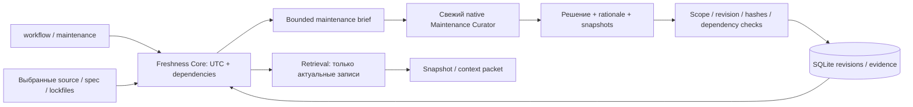

# RFC 006 — Срок актуальности и пересмотр знаний

Статус: реализация решения пользователя от 2026-11-11. Исходные RFC остаются Draft.

## Решение

Знания действуют 14 × 24 часа в UTC. При `now >= expires_at` запись исключается
из factual retrieval, get и expansion старого packet. История и evidence сохраняются.
Истечение — вычисляемое состояние, без daemon, массового удаления и ревизий на чтении.
Срок пакета дополнительно ограничен самым ранним deadline связанных знаний.
Обход графа ограничен 64 узлами/32 уровнями; цикл или превышение бюджета исключает
запись до уточнения зависимостей. В экспорт добавляются persisted_state, freshness и expires_at; active с истёкшим сроком
показывается как stale. Candidate не становится фактом от новой даты.

Новая observation отсчитывает срок от observed_at, ограниченного временем записи;
если дата не указана — от времени outcome задачи (не от позднего reconcile).
Явный review approve подтверждает запись заново. Чтение, retry, index sync, export,
изменение state на stale/retracted и публикация general срок не продлевают.
Для legacy: human_review/human_release — recorded_at, остальные — более ранняя из
observed_at/recorded_at. Установка обновления не выдаёт старым знаниям новые 14 дней.

## Зависимости и содержательный пересмотр

Project proposals могут указать dependencies: files (относительные пути выбранных
несекретных source/config/spec/lock-файлов) и entries (точные K@revision). Core сохраняет
хеши файлов и проверяет project scope ссылок. Нет сканирования всего диска, исполнения
команд из памяти, чтения secrets или автоматической загрузки внешних URL.

`knowledge maintenance --task T` готовит ограниченный brief отдельному свежему
Maintenance Curator: просроченные записи, прежние условия, изменения/исчезновение
прямых файлов, состояния связанных записей и транзитивные проблемы. Записи без
зависимостей явно отмечены unknown: агент находит источники, а не подтверждает по памяти.
Раз в 14 дней проверяются не только текст, но и spec, API, lockfiles, окружение и
связанные решения в пределах известных источников. Полноту зависимостей устанавливает
агент; неизменный хеш сам по себе не является подтверждением истинности.

Агент возвращает renew/stale/retract либо обновление через обычный proposal.
Renew сохраняет прежний claim и kind; нужны rationale и текущие file snapshots,
сохранённые Core как immutable evidence. Core проверяет хеши непосредственно перед
записью, expected_revision и прежние обязательные dependencies. Изменённый claim
проходит обычный candidate/review механизм. Автоматический пересмотр ограничен
project knowledge; general releases требуют явного review владельца.

Каждый успешный renew создаёт revision и новый 14-дневный интервал с audit о том,
что это содержательный agent review по источникам, а не независимо доказанный факт.
Неясность, недоступный источник, отсутствующая поддержка или конфликт дают stale
и следующую попытку через 14 дней; такой maintenance-stale можно подтвердить после
появления достаточных источников. Явный human-stale автоматически не восстанавливается;
опровержение — retract. Нельзя обновлять дату для опустошения очереди.

## Запуск и восстановление

Нативный knowledge-cycle выполняет maintenance перед основной задачей, затем создаёт
новый snapshot. `workflow start` также возвращает maintenance brief как напоминание;
уже начатая задача не получает новые ревизии задним числом. Review использует отдельную
служебную task с developer role. Просроченность durable: незавершённые записи остаются
due после перезапуска; завершённый неопределённый пересмотр откладывает следующую попытку на 14 дней; обработка ограничена batch size, следующий batch доступен повторно.
Повтор принятого решения с прежним expected_revision возвращает conflict и не продлевает
срок ещё раз. При отсутствии агента знания остаются исключёнными, maintenance pending
сообщается явно. Периодичность по доступу не обещает работу при выключенном компьютере.

## Архитектура

Ограничения: неполный dependency graph, нет автоматической проверки production или
семантического доказательства вывода; уже переданный LLM текст отозвать нельзя.
Изменение зависимостей вне известных paths требует их обнаружения агентом.
