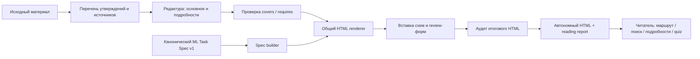

# RFC 007 — Короткий маршрут чтения HTML

Статус: реализация запроса пользователя от 2026-11-13. Исходные RFC остаются Draft.

## Проблема и решение

Объяснение многократно повторяет тезисы в контексте, схеме, деталях и выводе.
Новый стандарт для understand-changes и spec-init — основной маршрут на 5–7 минут
вместе с пятью вопросами. Полный материал остаётся в том же автономном HTML.
Не обещаем прочитать произвольный объём за семь минут: убираем повторы, сохраняем
существенные выводы и даём доступ к доказательствам по запросу.

Автор сначала составляет перечень утверждений с источниками и отмечает критические
ограничения. У каждого утверждения одно основное место. Схема объясняет связи;
текст добавляет причины, последствия и оговорки, вместо пересказа всех узлов.
Вторичные примеры, полный код и справочные таблицы размещаются в одном уровне details.
Критические риски и всё нужное для quiz остаются видимыми.

## Контракт и границы

understand-changes принимает прежний content v1 и новый v2. В v2 facts задаёт id,
statement, source, critical; covers связывает утверждение с блоком; requires связывает
вопрос с видимыми утверждениями. Сборка отклоняет пропуски, повторные размещения,
неизвестные ссылки, скрытые критические утверждения и скрытые опоры quiz.
Это проверка структуры. Автор и независимый reviewer проверяют смысл и полноту исходного списка.

ML Task Spec остаётся v1 с теми же 12 каноническими разделами. Меняется HTML review:
необязательные разделы раскрываются, scope, risks, требования, acceptance, открытые
и блокирующие gaps, оговорки Scout остаются видимыми. Optional reading выбирает
main_sections, critical_refs и quiz_requires. Критические ссылки автоматически
поднимают соответствующие элементы. Формы обратной связи не утверждают спецификацию.

## Архитектура

Общий модуль concise.py использует Python standard library. Браузеру не нужен сервер
приложения, сеть или внешний JS. Поиск раскрывает совпадения в деталях; ссылки на
разделы тоже раскрывают контейнеры. Перед печатью подробности открываются.

## Проверки и ограничения

Аудит выполняется после вставки схем и форм. Исходная эвристика: 160 слов/мин текста,
80 слов/мин кода, 30 секунд на видимую схему; quiz — 180 слов/мин плюс 9 секунд на вопрос,
включая один feedback. Это оценка, не пользовательский замер и не доказательство понимания.
Превышение семи минут выдаёт предупреждение, не удаляет информацию и не прячет обязательное.
Статический подсчёт зависит от структуры HTML и data-reading-ignore; произвольные
CSS/JS изменения видимости стороннего builder требуют проверки автором.

Точные и близкие повторы абзацев отмечаются для редактуры, но автоматически не удаляются.
Семантические повторы и неверно размеченный факт требуют содержательного review.
Legacy документы продолжают строиться; без facts полнота отмечается untracked.
Старые HTML не переписываются массово.

Результаты пилота и проверок: [evaluation](../evaluations/concise-html-2026-11-13.md).
