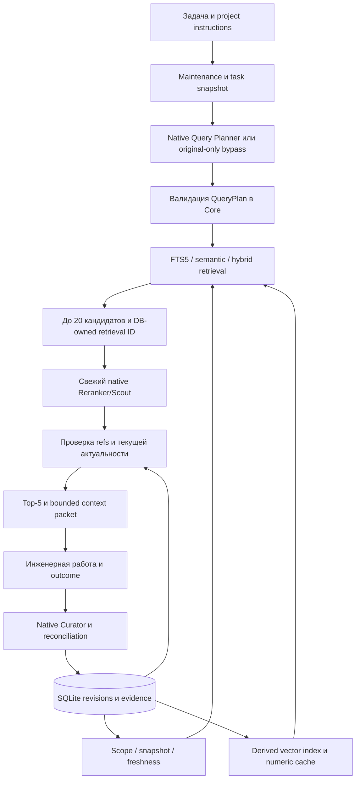

# RFC 007 — Быстрый exact retrieval и native reranking

Статус: Draft v0.1 с локальным пилотом реализации, 2026-11-13.
Scope реализации одобрен пользователем «делай» после
[knowledge-retrieval-improvements r1](../specs/knowledge-retrieval-improvements/r1/SPEC.md),
SHA-256 `79554f94002ab8327a14fdc4616b8c34642984834aeb6f4310fced3907f15262`.
Это не изменение статуса RFC 001 и не решение о полном переходе на Rust.

## Проблема и измеренное основание

[Исследование](../evaluations/knowledge-retrieval-2026-11-13.md) показало линейную
стоимость repeated JSON decode/normalization/Python dot-products и пользу второй
стадии на небольшом synthetic corpus. Безусловные decomposition и hybrid не
улучшили baseline. Поэтому пилот сохраняет semantic default установленного runtime,
оптимизирует exact scoring и добавляет управляемый native rerank с conditional rewrite.
Показатели synthetic исследования не являются production acceptance.

## Система целиком

Нативные шаги выполняет coding agent. Core не запускает собственный LLM loop,
SDK или network inference. Прямая передача JSON и доступность навыка в клиенте
не гарантируют автоматическое выполнение всех шагов: audit различает native и fallback.

## Численный слой

Одна bounded connection-local cache (оценка до 32 MiB) содержит нормализованные
векторы и contiguous NumPy float64 matrix. Без NumPy используется stdlib math.fsum.
Для cold CLI NumPy не импортируется первым scoring-вызовом: cache переводится
в matrix при reuse либо когда embedding backend уже загрузил NumPy.
Signature включает model identity, allowed IDs и фактические rows revision/hash/vector.
Сравнение raw serialized rows обнаруживает даже direct SQL изменения и rollback;
новый процесс строит cache заново. Близкие BLAS scores (<=1e-12) пересчитываются
reference fsum для сохранения детерминированных tie breaks.

Eligibility, TTL, dependency/source hashes, роли и snapshot не кэшируются.
JSON vector schema на диске сохраняется, cache производный и не требует migration.
Semantic больше не выполняет eager lexical fallback на успешном пути;
hybrid делает одну lexical retrieval, при ошибке fallback вычисляется заново.
Полные scans current records и чтение JSON rows ещё остаются: это следующий
кандидат на оптимизацию при подтверждённой нагрузке, а не скрытая гарантия O(log N).

## Протокол

Публичный интерфейс: `KnowledgeStore.retrieval_plan_brief`, `retrieve`,
`apply_rerank`; CLI `workflow start --retrieval staged`, `workflow retrieve`,
`workflow rerank`. Точные форматы и команды:
[retrieval skill reference](../../skills/knowledge-cycle/references/retrieval.md).

План привязан к task/role и дословному goal. Original всегда остаётся, один rewrite
опционален; до трёх subqueries и один hypothetical_document разрешены только
с `--experimental`. Уникальные ветви дают до 30 записей каждая; RRF k=60
и исходные exact-ID/ref/symbol hits формируют bounded pool. HyDE uses document encoder,
с отдельным namespace vector cache. Сгенерированный текст не становится knowledge claim.

Additive `retrieval_runs` хранит plan digest, binding и кандидатов. В `reranker.json`
нет плана, hypothetical text или fusion scores. Native ответ содержит только refs,
abstain и reason. Подставленные/повторные refs, чужой task/role или изменённый policy
отклоняются. Stale/current-revision checks повторяются после медленных этапов и
перед записью packet. Только разрешённые refs могут стать factual context.

При недоступности planner — original-only bypass. При недоступности reranker —
явный `--fallback --retrieval-id`; mode `retrieval_fallback` записывается в packet.
Некорректный ответ не превращается в тихий fallback. Native abstention создаёт пустой
packet; нет автоматического дополнения нерелевантными записями. Trace отражает
потерю источников и дополнительное сокращение budget.

## Совместимость и ограничения

Старый `workflow start` остаётся legacy, поэтому callers не начинают LLM-вызовы
неявно. Skill использует staged явно. Legacy taxonomy refinement сохраняется;
staged сохраняет routing по task paths и закрепляет его при первом packet.
Таблицы revisions/evidence и schema_version=1 не переписываются. Для rollback
достаточно legacy workflow/предыдущего кода; новая additive trace table игнорируется.

Native-agent latency/cost и качество другого cross-encoder не следуют из тестов
детерминированного Core. Не реализованы persistent inference worker, Rust backend,
ANN index, автоматическая чистка retrieval traces, защищённый private evaluator.
Claims в brief усечены до 2000 символов; пустой/abstaining result не доказывает
отсутствия знания в полном корпусе. Local cooperative profile не защищает от
владельца filesystem/SQLite. Перед production default для новых workloads нужен
фиксированный реальный task set, budget по latency и отдельная оценка ошибок.
